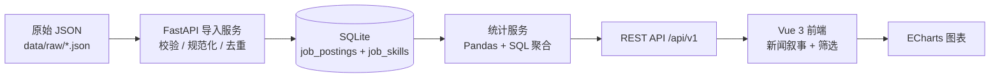

# 系统架构与接口约定

## 1. 总体架构



设计原则：

1. **统计在后端**：图表只消费统计接口，前端不重新计算占比，避免口径分叉。
2. **原始数据保留**：JSON 文件是事实来源，SQLite 是可重建的查询层。
3. **两层模型**：岗位主表 + 技能关联表，技能频率可用 SQL 聚合。
4. **显式分母**：所有比率都返回 `count` 与 `ratio`，并说明分母。
5. **简单优先**：课程项目不引入 Redis、MySQL、消息队列、复杂权限系统。

## 2. 技术栈

| 模块 | 技术 | 版本要求 |
| --- | --- | --- |
| 后端 | Python / FastAPI | Python ≥ 3.12，FastAPI ≥ 0.115 |
| ORM | SQLAlchemy | ≥ 2.0（2.0 typed mapping） |
| 校验 | Pydantic / pydantic-settings | ≥ 2.9 |
| 数据库 | SQLite | 文件 `backend/data/joblens.db` |
| 统计 | Pandas + SQL | 小组数据量 < 1000 条 |
| 前端 | Vue 3 / Vite / TypeScript | Node ≥ 20 |
| 图表 | ECharts | 5.x |
| 测试 | Pytest / HTTPX / FastAPI TestClient | — |
| CI | GitHub Actions | Ubuntu + Python 3.12 + Node 22 |

## 3. 目录职责

```
backend/app/
├── main.py           FastAPI 实例、CORS、启动建表
├── core/config.py    JOBLENS_* 环境变量
├── db/               engine、session、init_db
├── models/           ORM 表定义
├── schemas/          API 请求/响应与校验
├── api/v1/           路由层：只做参数绑定、调用 service
├── services/         业务：导入、规范化、筛选条件、统计
└── data/raw/         原始 JSON（仅演示数据当前入库）
```

路由层不写统计逻辑；统计逻辑不直接依赖 HTTP。这样便于测试与后续加入 CLI 脚本。

## 4. 数据库设计

### 4.1 `job_postings`

| 字段 | 类型 | 约束 | 说明 |
| --- | --- | --- | --- |
| id | VARCHAR(64) | PK | 原始记录唯一标识 |
| company | VARCHAR(200) | NOT NULL, INDEX | 企业名称 |
| position | VARCHAR(200) | NOT NULL, INDEX | 岗位名称 |
| job_type | VARCHAR(50) | NOT NULL, INDEX | 岗位类别 |
| city | VARCHAR(50) | NOT NULL, INDEX | 城市 |
| salary_min | INTEGER | NULL | 月薪下限（元） |
| salary_max | INTEGER | NULL | 月薪上限（元） |
| education | VARCHAR(30) | NOT NULL, INDEX | 学历要求 |
| experience | VARCHAR(30) | NOT NULL, INDEX | 经验要求 |
| is_fresh_graduate | BOOLEAN | NOT NULL, INDEX | 是否接受应届生 |
| description | TEXT | NOT NULL | 岗位描述 |
| source | VARCHAR(100) | NOT NULL | 数据来源 |
| source_url | VARCHAR(500) | NOT NULL | 原始链接 |
| collected_at | DATE | NULL, INDEX | 采集日期 |
| created_at | DATETIME | NOT NULL | 入库时间（UTC） |

复合索引（高频筛选组合）：

- `ix_job_postings_job_type_education (job_type, education)`
- `ix_job_postings_city_job_type (city, job_type)`
- `ix_job_postings_experience_education (experience, education)`

### 4.2 `job_skills`

| 字段 | 类型 | 约束 | 说明 |
| --- | --- | --- | --- |
| id | INTEGER | PK AUTOINCREMENT | — |
| job_id | VARCHAR(64) | FK → job_postings.id, CASCADE, INDEX | 岗位 |
| skill_name | VARCHAR(80) | NOT NULL, INDEX | 标准技能名 |

唯一约束：`uq_job_skills_job_skill (job_id, skill_name)`。

不采用“技能存 JSON 数组”的原因：SQLite 对 JSON 聚合与分组统计不友好，关联表可直接
`GROUP BY skill_name` 得到岗位覆盖数。

### 4.3 `import_batches`

每次 `import_dataset` 写入一条批次摘要，用于复现和交付说明。

| 字段 | 类型 | 约束 | 说明 |
| --- | --- | --- | --- |
| id | INTEGER | PK AUTOINCREMENT | — |
| dataset_name | VARCHAR(200) | NOT NULL | JSON 中的 dataset_name |
| source_file | VARCHAR(255) | NULL | 上传文件名 |
| on_conflict | VARCHAR(10) | NOT NULL | skip / update / fail |
| total_records | INTEGER | NOT NULL | JSON 记录数 |
| imported / updated / skipped / failed | INTEGER | NOT NULL | 各类处理结果计数 |
| created_at | DATETIME | NOT NULL | 导入时间（UTC） |

## 5. API 约定

Base URL：`http://127.0.0.1:8000/api/v1`；交互式文档：`/docs`。

### 5.1 接口清单

| 方法 | 路径 | 说明 |
| --- | --- | --- |
| GET | `/health` | 健康检查，含数据库连通性 |
| POST | `/imports/json` | 上传 JSON 数据集，参数 `on_conflict=skip\|update\|fail` |
| POST | `/imports/validate` | 只校验不入库的数据集预检；返回错误、警告与已有 id 计数 |
| GET | `/imports/batches` | 最近导入批次摘要，参数 `limit` |
| GET | `/jobs` | 分页查询岗位，支持多条件筛选 |
| GET | `/jobs/{job_id}` | 岗位详情 |
| GET | `/stats/overview` | 总量、企业数、平均/中位薪资、应届生占比 |
| GET | `/stats/education` | 学历分布、分岗位类别学历分布 |
| GET | `/stats/experience` | 经验分布、分岗位类别分布、应届生专项 |
| GET | `/stats/skills` | 技能排行、技能类别覆盖、分岗位类别 Top 技能 |
| GET | `/stats/salary` | 薪资分布、分岗位/学历/经验汇总 |
| GET | `/stats/quality` | 数据集质量摘要：薪资缺失/单边/异常、未知学历/经验、空技能、重复来源链接、演示记录 |
| GET | `/stats/cross` | 交叉计数：`row` 与 `column` 取 job_type / education / experience / city |
| GET | `/meta/filters` | 筛选下拉选项（岗位类别、学历、经验、城市、技能） |
| GET | `/exports/jobs.csv` | 按 `/jobs` 筛选导出 CSV（UTF-8 BOM，技能用分号分隔） |

### 5.2 查询参数

`/jobs`：

| 参数 | 类型 | 说明 |
| --- | --- | --- |
| job_type | string | 精确匹配岗位类别 |
| education | string | 精确匹配学历 |
| experience | string | 精确匹配经验 |
| city | string | 精确匹配城市 |
| skill | string | 精确匹配技能名（关联表查询，技能点击抽屉使用） |
| salary_min | int ≥ 0 | 期望月薪下限，按区间重叠匹配 |
| salary_max | int ≥ 0 | 期望月薪上限，按区间重叠匹配 |
| q | string | 岗位名称或企业名称模糊搜索 |
| page | int ≥ 1 | 默认 1 |
| page_size | int 1～100 | 默认 20 |

`/stats/education`、`/experience`、`/skills`、`/salary` 共用筛选：
`job_type`、`education`、`experience`、`city`（均为可选精确匹配）。

`/stats/skills` 额外参数：

| 参数 | 默认 | 说明 |
| --- | --- | --- |
| limit | 20 | 总体排行返回数量，1～100 |
| per_type_limit | 8 | 每个岗位类别返回数量，1～50 |

### 5.3 薪资匹配语义

岗位薪资 `[salary_min, salary_max]` 与查询区间 `[user_min, user_max]` **有交集**即匹配。
两端均为 `null`（面议）的岗位不会匹配任何薪资筛选条件；只有单边薪资的记录按已知边界参与重叠判断。

### 5.4 错误格式

统一保留 FastAPI 的 `detail` 字段（前端已依赖），并增加机器可读的 `code`；
422 额外返回字段级 `errors`：

```json
{ "detail": "招聘记录不存在", "code": "not_found" }
```

```json
{
  "detail": "请求参数校验失败",
  "code": "validation_error",
  "errors": [{ "loc": ["query", "page"], "msg": "Input should be greater than or equal to 1" }]
}
```

错误码：`bad_request` / `not_found` / `payload_too_large` / `validation_error` /
`service_unavailable` / `http_error`。OpenAPI 中通过 `ErrorResponse` 模型展示示例。

- 400：JSON 格式错误、字段校验失败、重复 id（`on_conflict=fail`）、文件为空/非 JSON/非 UTF-8。
- 404：岗位不存在。
- 413：文件超过 `JOBLENS_MAX_UPLOAD_BYTES`。
- 422：查询参数类型错误。
- 503：数据库不可用（健康检查）。

### 5.5 导入语义

- 逐条校验，坏记录进入 `errors`，不影响其他记录。
- 文件内重复 id 直接计为失败。
- 数据库已存在 id：`skip` 跳过、`update` 覆盖字段与技能、`fail` 计为失败。
- 单次事务提交；数据库写入异常时回滚并返回 500。
- 导入时执行：字符串 trim、学历/经验别名归一、技能去空格与大小写去重、`应届生` 标记校正、
  记录级 `collected_at` 为空时继承数据集日期。

### 5.6 前端数据状态与交互

- **演示模式**：前端读取 `GET /stats/quality`；当 `demo_records == total_jobs` 时显示
  演示条、印章与演示说明。`VITE_DEMO_MODE=true/false` 可强制开关。真实数据导入后
  演示提示自动消失；混合数据会显示“含 N 条演示记录”的提醒。
- **筛选与 URL**：学历/经验/技能/薪资页的四个筛选条件写入 URL query（`job_type`、
  `education`、`experience`、`city`），刷新与分享后保持；筛选后退化到 0 条时显示清除入口。
- **技能 → 岗位**：点击技能条形、数据表技能名或首页技能词墙，调用 `GET /jobs?skill=`
  在抽屉中展示匹配岗位；抽屉支持焦点陷阱、Esc 关闭与页面滚动锁定。
- **数据说明页**：消费 `/stats/quality`、`/imports/batches` 与 `/exports/jobs.csv`，
  展示质量检查、批次摘要与下载入口。

## 6. 统计口径

### 6.1 薪资

- 岗位月薪中点 `mid = (salary_min + salary_max) / 2`；只有一端时取该端。
- `avg`、`median`、`p25`、`p75`、`min`、`max` 均基于 `mid`，单位为元/月。
- 两端都为 `null` 的“面议”岗位**不进入**薪资计算，但计入 `total_jobs`。
- 直方图固定区间：`<8K`、`8–12K`、`12–16K`、`16–20K`、`20–30K`、`≥30K`。
- 前端必须展示 `salary_available` 与实际参与计算的样本量。

### 6.2 学历 / 经验

- `breakdown.ratio = 该类别岗位数 / total`，`total` 为当前筛选条件下的岗位数。
- `by_job_type` 为分层统计：分母是该岗位类别的岗位数。
- 学历/经验按规范化词表排序，未知值保留原文并排在最后。

### 6.3 技能

- `count` = 包含该技能的**去重岗位数**（`COUNT(DISTINCT job_id)`）。
- `ratio` = `count / total_jobs`；`total_jobs` 为当前筛选条件下的岗位数。
- 同一岗位同一技能只能出现一次（数据库唯一约束）。
- 分岗位类别统计时，分母是该岗位类别的岗位数，不是总样本。
- `category` 来自 `backend/app/services/skills.py` 词表，未收录技能归入“其他”。
- `categories` 的 `count` 为“至少包含一项该类别技能的岗位数”；一条岗位可同时计入多个
  类别，因此类别覆盖数**不可相加**，也不构成 100% 的构成比。

### 6.4 应届生

- 以显式字段 `is_fresh_graduate` 为准；导入时若 `experience = 应届生` 则自动置为 `true`。
- `fresh_graduate_ratio = fresh_graduate_count / total_jobs`。
- “经验不限”不等同于“接受应届生”，除非原始数据明确标注。

### 6.5 数据质量

`POST /imports/validate` 与 `scripts/check_dataset.py` 共用同一套只读检查：

- 必填字段：id / company / position / job_type / city / education / experience /
  source / source_url / collected_at；缺失只计入质量报告，不改变已有记录的入库规则。
- 未知学历/经验：先按别名归一，再与规范词表比较；未知值保留原文并列入报告。
- 薪资异常：已知边界 < 2000 或 > 100000 元/月；面议与单边薪资分别计数。
- 技能：为空、超过 10 项、重复技能条目分别计数；重复项导入时去重。
- 重复 id：同一文件内重复会阻止该行导入；已存在于数据库的 id 单独计数，按
  `on_conflict` 处理。
- 演示记录：source 含“演示/虚构”或 source_url 含 `example.com` 的岗位单独计数，
  用于防止演示数据混入正式结论。

`GET /stats/quality` 对已入库数据做同类检查；它不替代人工抽样核验。

### 6.6 交叉统计

`GET /stats/cross?row=job_type&column=education` 返回按 `row` 分组的 `column`
分布，复用 `/stats/*` 的筛选参数。`row == column` 时返回对角线；前端目前未消费该接口，
保留给报告与后续交互使用。`groups[].distribution[].ratio` 的分母是该行的岗位数。

## 7. 配置项

| 环境变量 | 默认值 | 说明 |
| --- | --- | --- |
| `JOBLENS_DATABASE_URL` | `sqlite:///backend/data/joblens.db` | SQLAlchemy URL |
| `JOBLENS_CORS_ORIGINS` | `["http://localhost:5173"]` | JSON 数组 |
| `JOBLENS_MAX_UPLOAD_BYTES` | 10485760 | 单文件上限 |
| `JOBLENS_DEBUG` | false | FastAPI debug |
| `VITE_API_BASE_URL` | `/api/v1` | 前端接口基址 |

## 8. 本地开发

一条命令启动前后端（首次运行自动创建虚拟环境并安装依赖）：

```bash
# 在项目根目录
npm run dev
```

等价于同时运行：

```bash
# 后端
cd backend
.venv/Scripts/activate      # Windows
python -m uvicorn app.main:app --reload --host 127.0.0.1 --port 8000

# 前端
cd frontend
npm run dev
```

联调路径：前端 → Vite `/api` 代理 → FastAPI → SQLite。启动器实现见
`scripts/dev.mjs`，支持 `npm run dev:backend` / `npm run dev:frontend` 单独启动。

### 8.1 正式数据的检查与导入

```bash
cd backend

# 1. 离线检查（不启动服务、不写库）
python -m scripts.check_dataset data/raw/jobs_hangzhou_2026-11.json
python -m scripts.check_dataset data/raw/jobs_hangzhou_2026-11.json --json > quality.json

# 2. 服务启动后预检（不写库，额外报告数据库中已有 id）
curl -X POST "http://127.0.0.1:8000/api/v1/imports/validate" \
  -F "file=@data/raw/jobs_hangzhou_2026-11.json"

# 3. 确认后正式导入
curl -X POST "http://127.0.0.1:8000/api/v1/imports/json?on_conflict=skip" \
  -F "file=@data/raw/jobs_hangzhou_2026-11.json"

# 4. 查看批次与质量摘要
curl "http://127.0.0.1:8000/api/v1/imports/batches"
curl "http://127.0.0.1:8000/api/v1/stats/quality"

# 5. 独立重算统计并与 API 逐项核对（必须传入已导入的同一份 JSON）
python -m scripts.verify_stats data/raw/jobs_hangzhou_2026-11.json --json > verify.json
```

`verify_stats.py` 用 Pandas 从原始 JSON 重算学历、经验、技能、薪资（含分岗位类别、
学历、经验的分组），逐项对比 API；演示数据当前 359/359 项一致。

### 8.2 重建与性能基准

```bash
# 字段/索引变化后：先停止 API，再重建并重新导入
python -m scripts.reset_db --yes

# 500 条临时数据下的接口延迟（临时 DB，不影响现有数据）
python -m scripts.benchmark_api
```

演示数据下所有接口 median 与 p95 均低于 300ms。交付报告生成在
`backend/data/reports/`，说明见该目录的 README。

## 9. 已知取舍

- 不使用 Alembic：字段/索引变化时停止服务，运行 `scripts/reset_db.py --yes`
  删除数据库并重新导入（数据文件是事实来源）。
- 不引入用户体系与写接口权限：课程作品只读展示。
- 技能分类是人工词表，不做 NLP 自动抽取；词表质量直接决定“其他”占比。
- 统计在 Pandas 中完成，适用于数百条数据；数据量显著增长时应下推到 SQL。
- 演示数据为虚构，正式结论必须使用真实采集数据。
